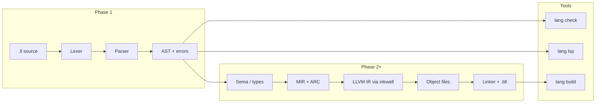

# Toolchain architecture

The LLLang toolchain is a Rust workspace that shares front-end artifacts between the CLI, batch checker, and Language Server. Phase 2 delivers sema → MIR/ARC → LLVM 22 (`inkwell`) → native `lang build`/`run`; see ADRs [007](adr/007-error-abi.md) and [008](adr/008-object-layout.md).

## Workspace layout

```text
llang/
├── Cargo.toml                 # workspace root
├── crates/
│   ├── lllang-syntax/         # lexer, parser, AST, fmt, LL0xxx diagnostics
│   ├── lllang-manifest/       # Package.ll / Solution.ll
│   ├── lllang-sema/           # name resolution, type check, symbol index
│   ├── lllang-mir/            # MIR + ARC
│   ├── lllang-llvm/           # inkwell LLVM 22 codegen
│   ├── lllang-pack/           # .sbl/.bll, store, Package.lock
│   ├── lllang-lsp/            # tower-lsp (diagnostics, nav, fmt, inlays)
│   └── lang/                  # `lang` CLI
├── docs/                      # spec, guides, ADRs
├── editors/                   # VS Code, TextMate, web highlighters
└── skills/                    # agent skills mirroring docs
```

Phase 2–3 crates implement the vertical compile slice plus packing; `runtime/lllang_rt.c` provides ARC, JSON/TOON/HTTP/LLM MVP helpers.

## Compilation pipeline



### Phase 1 (complete)

| Stage | Output | User-visible |
|-------|--------|--------------|
| Lex | Token stream + `LL0001`–`LL0099` | Red squiggles in editor |
| Parse | AST + `LL0100`–`LL0799` | `lang check`, LSP diagnostics |
| — | No type checker yet | Symbols/folding from syntax tree |

Design constraint: **one parser** feeds CLI and LSP. No duplicate grammars in TypeScript except TextMate for highlighting (maintained to match spec).

### Phase 2 and later

| Stage | Notes |
|-------|-------|
| Name resolution | Modules via `namespace` + `import`; merge `.sbl` from dependencies |
| Type checking | Local inference; typed throws; protocol witnesses |
| Memory | ARC retain/release insertion, weak/unowned rules, exclusivity |
| LLVM 22 | via [inkwell](https://github.com/TheDan64/inkwell) pinned to LLVM 22 sys crate |
| Runtime | Small `Std.Runtime` for ARC, traps, task scheduler hooks |

`lang build` orchestrates: resolve lockfile → fetch `.bll` for target triple → compile project `.ll` → link.

## LLVM / inkwell strategy

- **Target:** LLVM 22 toolchains on macOS, Linux, Windows (matching CI images).
- **Binding:** inkwell for structured IR builder API in Rust; fallback to llvm-sys for thin wrappers if needed.
- **IR ownership:** LLLang owns a thin mid-level layer (MIR) so ARC and calling conventions are not expressed ad hoc in every codegen path.
- **LTO:** Optional thin LTO at link via `Package.ll` build settings.

Phase 2 requires LLVM 22 (`LLVM_SYS_221_PREFIX`). Syntax-only crates still build without LLVM.

## Language Server (`tower-lsp`)

The `lllang-lsp` crate wraps `tower-lsp` on Tokio stdio. Phase 1 capabilities:

- Pull diagnostics from parse errors (`LL0xxx`)
- Document symbols, folding ranges, semantic tokens (syntax-kind based)
- Incremental sync (`didChange` incremental text)

Phase 2 publishes sema diagnostics alongside syntax. Phase 2.1 adds go-to-definition, find references, and inlay hints. Phase 4 adds type-aware completion and code actions.

See [ADR 006 — tower-lsp](adr/006-tower-lsp.md).

## CLI (`lang`)

| Command | Phase | Role |
|---------|-------|------|
| `lang check` | 1 | Parse trees + diagnostics |
| `lang lsp` | 1 | Spawn LSP server |
| `lang build` / `run` | 2 | Native binary output |
| `lang fmt` | 2 | Formatter driven by AST + style rules |
| `lang add` / `pack` | 3 | Package graph + `.bll` publish |
| `lang llm gen` | 3 | Emit `.mll` from module graph |

Manifest: `Package.ll` / `Solution.ll` (package name, targets, dependencies, feature flags for `#if`).

## Editor integration

- **VS Code / Cursor:** extension launches `lang lsp`; grammar from TextMate plist aligned with [keywords](../spec/keywords.md).
- **Web:** Shiki / highlight.js grammars for docs and playgrounds.
- **Future:** Tree-sitter optional for incremental highlighting in non-LSP contexts.

## Testing strategy

| Layer | Tests |
|-------|-------|
| Lexer/parser | Snapshot diagnostics + AST snapshots per construct |
| Sema (later) | Type-directed tests + negative cases per `LL2xxx` |
| CLI | Integration tests invoking `lang check` on `examples/` |
| LSP | JSON-RPC fixture tests for publishDiagnostics |

## Observability

Phase 1: structured errors to stderr with codes. Phase 2+: `-v` trace flags for pass timings; optional `--emit-mir` / `--emit-llvm` for debugging.

## Related

- [Roadmap](../../ROADMAP.md)
- [Diagnostics](../spec/diagnostics.md)
- [Package manager](../packages/package-manager.md) (design)
- ADRs: [ARC](adr/001-arc-memory.md), [static dispatch](adr/002-static-dispatch-default.md), [prebuilt libs](adr/003-prebuilt-libraries.md)
