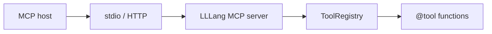

# MCP integration

The **Model Context Protocol (MCP)** lets external agent hosts (IDEs, desktop apps, orchestrators) discover and invoke tools. LLLang supports MCP through project templates, TOON tool descriptors, and bridges to **`Std.Llm`** tool registries.

## Scaffold

```bash
lang new mcp -n my.server
```

Typical layout:

```text
my.server/
  lang.toml
  package.mll
  src/
    main.ll
    tools.ll
  mll/
    tools.toon
```

The `mcp` template includes sample `@tool` handlers and a stdio MCP transport stub.

## Architecture



- **Host** sends `tools/list` and `tools/call` JSON-RPC messages.
- **Server** translates calls to `ToolRegistry.dispatch`.
- **Tools** are ordinary LLLang async functions with typed arguments.

## Tool descriptors (`mll/tools.toon`)

Keep machine-readable catalogs for hosts that ingest TOON:

```toon
version: "1"
tools:
  - name: search_issues
    description: Search issues by label
    inputSchema:
      type: object
      properties:
        label: { type: string }
        limit: { type: integer, default: 10 }
      required: [label]
```

Generate from source when possible:

```bash
lang llm gen -p my.server
```

Prefer single source of truth: `@tool` functions → emitted schema → optional TOON export via `Tools.schema`.

## Server sketch

```ll
import Std.Llm
import Std.Json

@CLI.Root("my.server", summary: "MCP tool server")
public struct Main {
    @CLI.Run
    public async func run() async throws(AppError) {
        var registry = ToolRegistry()
        registry.register(searchIssues.self, handler: .function(searchIssues))
        let transport = McpStdioTransport()
        try await McpServer.serve(transport: transport, tools: registry)
    }
}
```

`McpServer` (stdlib) maps MCP content types to `String` / `Data` tool results and surfaces structured content as JSON strings.

## Transports

| Transport | Use case |
|-----------|----------|
| stdio | Cursor, Claude Desktop, local agents |
| HTTP + SSE | Remote shared servers (auth required) |

Configure in `lang.toml`:

```toml
[package]
kind = "app"

[mcp]
transport = "stdio"
# transport = "http"
# bind = "127.0.0.1:8787"
```

## Security

- Treat MCP hosts as **trusted only if** the OS user trusts them — tools run with the server’s privileges.
- Authenticate HTTP transports (mTLS or bearer tokens).
- Never register tools that exfiltrate secrets from `.env` or keychains.
- Log tool invocations with [Std.Log](../stdlib/log.md) at `info` or `audit` level.

## Context resources

MCP **resources** can expose `.mll` bundles:

```ll
public struct PackageResource: McpResource {
    public var uri: String = "lllang://my.server/package.mll"
    public func read() async throws(McpError) -> String {
        try LlmContext.loadMll(Path("package.mll"))
    }
}
```

Hosts pull static context without pasting large prompts manually.

## Testing

Use MCP inspector clients or stub transports in tests:

```ll
@Test
func listsTools() async throws {
    let client = McpTestClient(server: makeTestServer())
    let tools = try await client.listTools()
    expect(tools.contains { $0.name == "search_issues" })
}
```

## See also

- [Tools & structured output](tools-and-structured-output.md)
- [Context generation](context-generation.md)
- [`.mll` format](../formats/mll.md)
- Template: `lang new mcp` ([Templates](../toolchain/templates.md))
