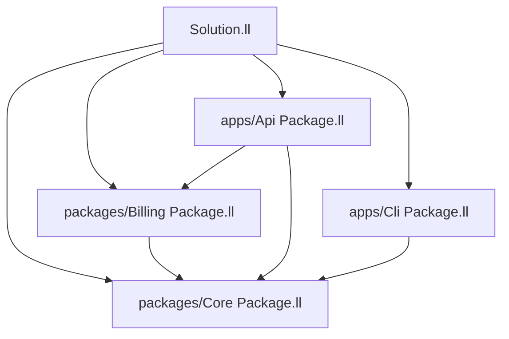

# Solutions (monorepos)

LLLang **solutions** group multiple packages the way a .NET **`.sln`** groups projects. Each member remains a normal package with its own `Package.ll` (SwiftPM-style). The root `Solution.ll` only describes **which packages belong together**, build order hints, and defaults — it does not replace per-package manifests.

This split mirrors:

| Ecosystem | Per-project | Multi-project |
|-----------|-------------|-----------------|
| SwiftPM | `Package.swift` | (workspace / Xcode only) |
| .NET | `.csproj` | `.sln` |
| **LLLang** | `Package.ll` | `Solution.ll` |

## When to use a solution

- Monorepos with apps + shared libraries
- Shared CI that builds/tests several packages in one command
- Path dependencies between sibling packages without publishing
- Editor / LSP multi-root awareness (`lang lsp` discovers solution members)

A **single** package repo needs only `Package.ll`. Add `Solution.ll` when you have two or more packages you want to treat as one unit of work.

## Layout

```text
shop/                          # solution root
  Solution.ll                  # lists member packages
  Package.lock                 # optional shared lock for the solution
  packages/
    Core/
      Package.ll
      Sources/Core/...
    Billing/
      Package.ll
      Sources/Billing/...
  apps/
    Api/
      Package.ll
      Sources/Api/...
    Cli/
      Package.ll
      Sources/Cli/...
  tests/                       # optional solution-level integration tests (own Package.ll)
    Integration/
      Package.ll
```

Sibling packages refer to each other with **path dependencies** in `Package.ll`:

```ll
dependencies: [
    .package(path: "../Core"),
    .package(path: "../Billing"),
],
```

## `Solution.ll`

```ll
// lang-tools-version: 0.1
import Std.SolutionDescription

let solution = Solution(
    name: "Shop",
    projects: [
        .package(path: "packages/Core"),
        .package(path: "packages/Billing"),
        .package(path: "apps/Api"),
        .package(path: "apps/Cli"),
        .package(path: "tests/Integration"),
    ],
    defaultProjects: ["Api", "Cli"],
    configurations: [
        .debug,
        .release,
    ],
)
```

### Fields

| Field | Description |
|-------|-------------|
| `name` | Human / CI label for the solution |
| `projects` | Member packages (path relative to `Solution.ll`) |
| `defaultProjects` | Product or package names built by bare `lang build` / `lang test` |
| `configurations` | Named build configurations exposed to `lang build -c` |

### Project entries

```ll
.package(path: "apps/Api")
.package(path: "packages/Core", name: "Shop.Core")   // optional override display name
```

The **package name** still comes from each member’s `Package.ll`. The optional `name:` is only for solution-level selection (`--project Shop.Core`).

## CLI (solution-aware)

Commands run from a directory that contains `Solution.ll` (or via `--solution`) operate on the solution:

| Command | Behavior |
|---------|----------|
| `lang build` | Build `defaultProjects` (or all with `--all`) |
| `lang build --project Api` | Build one member (and its path deps) |
| `lang test` | Test default projects / `--all` |
| `lang check` | Syntax-check all member sources |
| `lang restore` | Resolve shared or per-package locks |
| `lang solution list` | Print members (planned) |
| `lang solution add <path>` | Append a project path to `Solution.ll` (planned) |
| `lang solution remove <name>` | Remove a member (planned) |
| `lang new solution -n Shop` | Scaffold root `Solution.ll` + starter packages (planned) |
| `lang new lib -o packages/Foo` | Create package; optionally `--solution` to register it |

Selecting a nested package directory (with its own `Package.ll` and no solution) behaves like a single-package repo.

## Build graph



1. Load `Solution.ll` and each member `Package.ll`
2. Merge path + registry dependencies into one resolve graph
3. Type-check using `.sbl` from the store / path packages
4. Build targets in topological order; link apps against member `.bll` outputs when packing locally

Local path packages are built from source **in this solution**; published registry deps remain prebuilt `.bll` (never recompiled).

## Solution vs package workspace

Do **not** put a `[workspace]` table in a TOML file — that model is retired. Prefer:

1. **One package, many targets/products** → only `Package.ll` (like a medium Swift package)
2. **Many packages, shared release train** → `Solution.ll` + path deps (like a .NET solution)

## Editor / LSP

- Opening the solution root activates multi-package diagnostics
- `documentSymbol` and future go-to-def cross package boundaries via path deps
- See [LSP](lsp.md)

## See also

- [Manifest (`Package.ll`)](manifest.md)
- [Templates](templates.md) — `solution` scaffold
- [Package manager](../packages/package-manager.md)
- [Std.SolutionDescription](../stdlib/solution-description.md)
